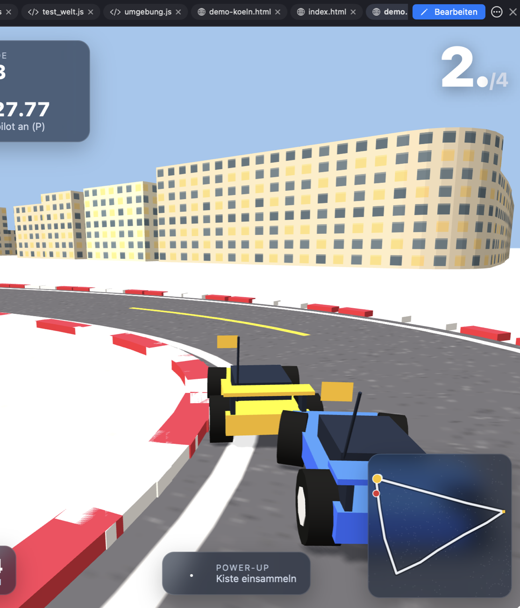

# Stadtflitzer 3D

Rennspiel mit ferngesteuerten Spielzeugautos – wie der Klassiker Re-Volt, aber durch **echte Innenstädte**:
München, Hamburg, Berlin und Köln. Straßenführung entlang echter Straßen, **echte Gebäudeumrisse aus OpenStreetMap**,
Wahrzeichen (Frauenkirche, Elbphilharmonie, Fernsehturm, Kölner Dom …). Die Autos sind klein, die Stadt ist riesig.

## Spielen

**Doppelklick auf `index.html`** – läuft im Browser ohne Server und ohne Internet (three.js liegt bei).
Oder in KI/lokal: Datei in der Vorschau öffnen. `demo.html` startet eine Vorführung mit Autopilot.

| Taste | Funktion |
|---|---|
| ↑ ↓ ← → oder W A S D | Gas, Bremse/rückwärts, lenken |
| Leertaste | Power-up einsetzen |
| R | zurück auf die Straße |
| P | Autopilot an/aus |
| T | Ton an/aus |
| M | Menü |

Auf Touch-Geräten erscheinen Knöpfe. Drei Runden gegen drei Computer-Gegner; du startest von hinten.

**Power-ups** (leuchtende Kisten auf der Strecke): 🔋 **Batterie-Turbo** (3 s schneller), 💧 **Wasserbombe**
(sucht das Auto vor dir und bremst es aus), 🛢️ **Öllache** (hinter dir – wer drüberfährt, schleudert).

## Aufbau

| Datei | Inhalt |
|---|---|
| `tools/cities.json` | Strecken (echte Straßen, Breite/Länge), Wahrzeichen, Farben, Kartenausschnitt |
| `tools/osm_daten.py` | holt Gebäude, Wasser und Parks über die Overpass-API und schreibt `data/<stadt>.js` |
| `js/world.js` | Stadt: Asphalt mit Markierungen, Randsteine, Startportal, Fassaden mit Fenstern, Wasser, Parks mit Bäumen, Wahrzeichen |
| `js/car.js` | Spielzeugauto: Modell, Arcade-Physik mit leichtem Driften, Abprallen am Rand, Computer-Gegner |
| `js/race.js` | Countdown, Runden mit Kontrollpunkt, Platzierung, Zeiten, Power-ups |
| `js/ui.js` | Menü, HUD, Minimap, Ziel-Bildschirm, Ton (WebAudio) |
| `js/main.js` | Renderer, Licht und Schatten, Verfolgerkamera, Spielschleife, Steuerung, Vorführmodus |
| `tests/` | Abnahmetests ohne Browser: `node tests/test_welt.js`, `test_auto.js`, `test_rennen.js` |

## Wie das Spiel entstanden ist (ehrlich)

Der Auftrag ging an den **lokalen Agenten von KI/lokal** (Ornith 1.5 35B, 3 Bit, auf einem MacBook Air mit 24 GB),
gesteuert von Claude als „großem Bruder“ mit Design-Dokument, Aufgaben in kleinen Stufen und Abnahmetests.

- **Vom lokalen Agenten:** die OpenStreetMap-Datenpipeline `tools/osm_daten.py` (Abfrage, Umrechnung in Meter,
  Höhen aus den Gebäude-Tags, Auswahl entlang der Strecke) inklusive mehrerer selbst gefundener Fehler, und die vierte
  Stadt **Köln** auf dem fertigen Spiel (Eintrag in `cities.json`, Einbindung in Seite, Menü und Tests – in 2 Minuten,
  alle Änderungen auf Anhieb richtig). Die Datenabfrage für Köln habe ich einmal neu angestoßen, nachdem Overpass die
  vielen Wiederholungen des Agenten gedrosselt hatte.
- **Von Claude:** Design-Dokument, Abnahmetests, Streckenführung in `cities.json` sowie die Spiel-Engine
  (`world.js`, `car.js`, `race.js`, `ui.js`, `main.js`, `index.html`). Die ersten Versionen von Stadtbau und Hauptschleife
  hatte der lokale Agent geschrieben; sie blieben nach mehreren Runden fehlerhaft (unsichtbare Gebäude, minutenlange
  Ladezeit) und wurden ersetzt.
- **Was der Versuch für KI/lokal gebracht hat:** Jede Schwäche des kleinen Modells wurde zu einer Verbesserung der App –
  automatische Syntax- und Browser-Prüfung (auch für hängende Seiten), Qualitäts-Check mit Projekttests vor „fertig“,
  Erinnerung bei bloßen Ankündigungen und beim Ausweichen vor Werkzeugen, `replace_lines` statt fehleranfälliger
  Textersetzung, Hilfe bei ungenauem `edit_file`, Warnung beim Überschreiben, Erkennung der Programme auf dem Mac
  (inkl. Python ohne HTTPS-Zertifikate) und eine Speicherverwaltung für den Verlauf, die auf 24 GB funktioniert.

Kartendaten © OpenStreetMap-Mitwirkende, ODbL. three.js r149 (MIT, `lib/THREE-LICENSE.txt`).
