# KI/lokal – Anleitung

**KI für alle – direkt auf deinem Mac.** KI/lokal ist ein Tool von [KIsruptiv](https://kisruptiv.de): ein KI-Agent,
der vollständig auf deinem Mac läuft – privat, offline, ohne Abo. Diese Anleitung zeigt jeden Bereich der App.

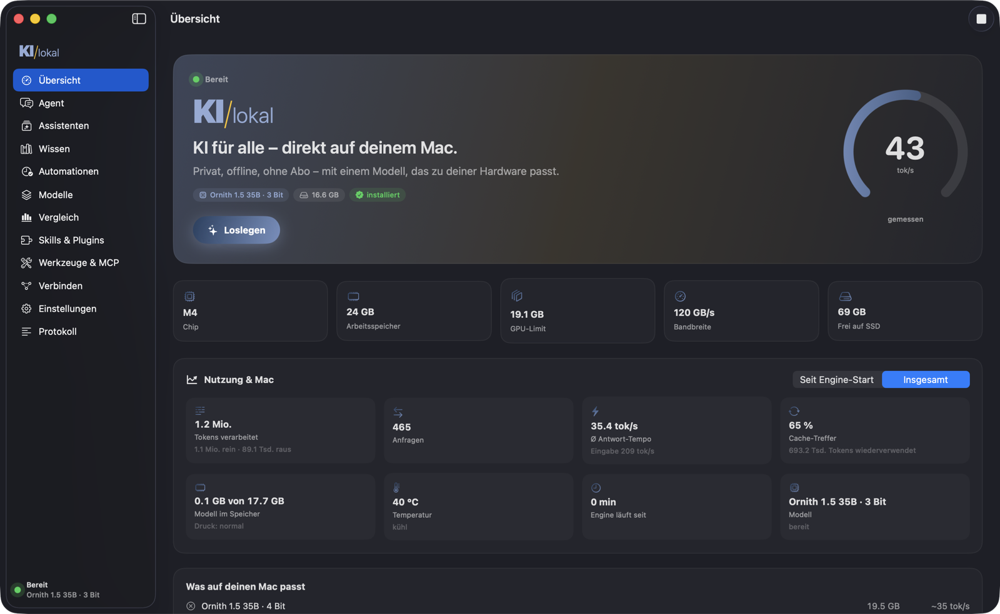

## Inhalt

1. [Installation und erster Start](#1-installation-und-erster-start)
2. [Übersicht: Hardware, Nutzung, Temperatur](#2-übersicht)
3. [Agent: chatten, arbeiten, programmieren](#3-agent)
4. [Projekte und Gesprächsliste](#4-projekte-und-gesprächsliste)
5. [Vorschau und Canvas](#5-vorschau-und-canvas)
6. [Dateien anhängen und Dokumente erzeugen](#6-dateien-anhängen-und-dokumente-erzeugen)
7. [Assistenten (fertige Funktionen) und Transkription](#7-assistenten)
8. [Skills: Abläufe wiederverwenden](#8-skills)
9. [Freigaben, YOLO und Notbremse](#9-freigaben-yolo-und-notbremse)
10. [Wissen, Automationen, Modelle, Vergleich](#10-weitere-bereiche)
11. [iPhone, Heimnetz und andere Programme](#11-iphone-heimnetz-und-andere-programme)
12. [Terminal und Links](#12-terminal-und-links)
13. [Datenschutz](#13-datenschutz)
14. [Wenn etwas hakt](#14-wenn-etwas-hakt)

---

## 1. Installation und erster Start

1. **DMG öffnen** (`KI-lokal-0.6.0.dmg`) und *KI/lokal* in den Programme-Ordner ziehen – oder selbst bauen:
   `app/Scripts/build.sh --run` (braucht Xcode und `brew install xcodegen`).
2. **Engine einrichten:** Beim ersten Start schlägt die Übersicht „Engine einrichten“ vor. KI/lokal installiert
   [oMLX](https://github.com/jundot/omlx) nach `~/.kilokal` – einmalig, ein paar Minuten.
3. **Modell laden:** Unter *Modelle* das empfohlene Modell laden (auf 24 GB: **Ornith 1.5 35B · 3 Bit**, 16,6 GB).
4. **Loslegen:** Im *Agent* einfach schreiben. Läuft die Engine noch nicht, startet KI/lokal sie beim Abschicken selbst
   (beim ersten Mal lädt das Modell ~20–30 s, danach antwortet es nach 1–4 s).

> **Tipp:** Mit wenig freiem Arbeitsspeicher hilft „GPU-Speicher erhöhen“ in den Einstellungen (fragt nach deinem Passwort,
> gilt bis zum Neustart).

## 2. Übersicht

Die Übersicht zeigt, was dein Mac kann (Chip, Arbeitsspeicher, GPU-Limit, Bandbreite, freier SSD-Platz), welche Modelle
passen und wie schnell sie laufen. Darunter **Nutzung & Mac** – aktualisiert sich alle 5 Sekunden:

| Kachel | Bedeutung |
|---|---|
| Tokens verarbeitet | Eingabe (Prompt) + Ausgabe – seit Engine-Start oder insgesamt |
| Anfragen | Zahl der Anfragen an das Modell, laufende Anfragen live |
| Ø Antwort-Tempo | Ausgabe in Tokens pro Sekunde; darunter das Eingabe-Tempo |
| Cache-Treffer | Anteil der Eingabe, die aus dem Cache kam (spart Zeit bei langen Gesprächen) |
| Modell im Speicher | belegter Speicher und Speicherdruck |
| **Temperatur** | Chip-Temperatur in °C und Zustand (kühl · warm · heiß · kritisch) |

Wird der Mac heiß, drosselt macOS – lange Agent-Läufe werden langsamer (auf dem MacBook Air gemessen bis −24 %).
KI/lokal zeigt das mit einem Hinweis an.

## 3. Agent

Ein Eingabefeld für alles: Fragen beantworten, im Web recherchieren, Dateien bearbeiten, Termine anlegen, den Browser
steuern, programmieren. Der Agent wählt seine Werkzeuge selbst.

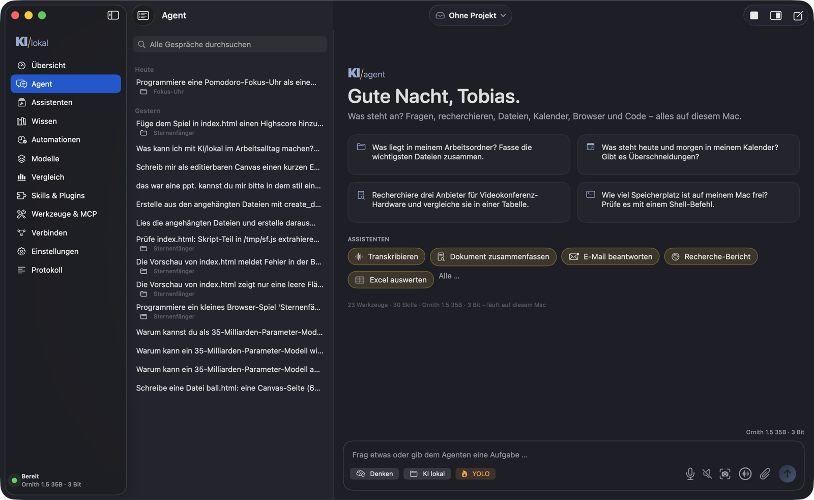

Der Start zeigt Vorschläge und die wichtigsten [Assistenten](#7-assistenten) als Knöpfe. Antworten erscheinen mit
Überschriften, Listen und Tabellen; darunter Tempo (tok/s), Tokens und die Zeit bis zum ersten Wort.

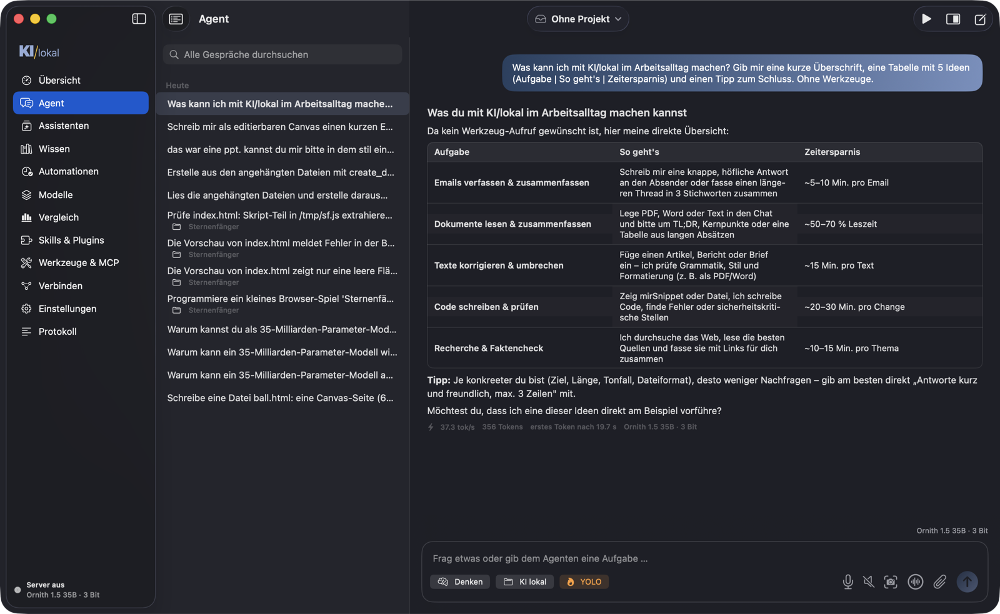

**Arbeitsschritte:** Was der Agent unterwegs tut (Dateien lesen, Befehle, Websuche …), steht kompakt in einer Zeile –
z. B. *„4 Arbeitsschritte · 1 Datei geändert · Prüfung bestanden“*. Ein Klick klappt die Schritte in Klartext auf
(„Gelesen: index.html“, „Im Web gesucht: …“), ein weiterer Klick auf einen Schritt zeigt Befehl und Ergebnis.

**Unter dem Eingabefeld:**

| Element | Funktion |
|---|---|
| Denken | Das Modell überlegt erst, dann antwortet es (gründlicher, langsamer) |
| 📁 Ordner | Arbeitsordner des Gesprächs (ohne Projekt: `~/Dokumente/KI lokal`) |
| 🔥 YOLO | Werkzeuge ohne Nachfrage ausführen (siehe [Freigaben](#9-freigaben-yolo-und-notbremse)) |
| 🎙 Mikrofon | Diktieren (Spracherkennung auf dem Mac) |
| 🔈 Lautsprecher | Antworten vorlesen an/aus |
| 📷 Kamera | Bildschirmfoto anhängen (ganzer Bildschirm, Bereich, Fenster) |
| 〰️ Wellen | **Gesprächsmodus:** sprechen – nach einer Pause wird abgeschickt – die Antwort wird vorgelesen – weiter sprechen |
| 📎 Büroklammer | Dateien anhängen (auch per Drag & Drop) |

Während der Agent arbeitet, zeigt er an, was gerade passiert („liest Eingabe … 12 s“, „denkt nach“, Tempo in tok/s).

**Qualität eingebaut:** Das lokale Modell ist schnell, übersieht aber manchmal Fehler. Deshalb prüft KI/lokal selbst mit:
- Die App kennt die Programme auf deinem Mac (node, python3, git …) und sagt sie dem Modell – kein Suchen, kein Raten.
- Nach jedem Schreiben prüft sie die Datei automatisch: JavaScript, JSON, Python, Shell auf Syntax; **HTML-Seiten werden
  unsichtbar im Browser geladen** und auf Fehler geprüft. Der Befund mit Zeilennummer geht sofort an den Agenten.
- Bevor der Agent „fertig“ meldet, macht er einen **Qualitäts-Check**: Befunde behoben? Auftrag vollständig? Texte ohne
  Tippfehler? Was fehlt, behebt er selbst.
- Wird eine Antwort am Längenlimit abgeschnitten, macht er in kleineren Teilen weiter; kurz vor dem Schrittlimit wird er
  erinnert, zum Ende zu kommen.
Erreicht ein Auftrag das Schrittlimit, erscheint **Weitermachen**. Nach gelungenen Abläufen mit mehreren Schritten schlägt
KI/lokal vor, sie [als Skill zu speichern](#8-skills).

## 4. Projekte und Gesprächsliste

**Projekte** bündeln Gespräche, einen Ordner und eigene Anweisungen – wie Projekte bei ChatGPT oder Claude. Oben in der
Mitte wählst du *Ohne Projekt* oder ein Projekt; *Neues Projekt …* legt eins an (Name, Ordner, Anweisungen).

- **Liegt im Ordner Code** (`.git`, `package.json`, `index.html` …), arbeitet der Agent automatisch wie ein Coding-Agent:
  Code-Werkzeuge, prüft nach jeder Änderung, schnelles Dekodieren (MTP, ~80 tok/s) – erkennbar am Kennzeichen **Code**.
- Die Arbeitsweise lässt sich im Projekt auch fest einstellen (Automatisch · Nur Chat · Arbeiten · Code).

**Gesprächsliste** (Symbol links oben im Agent): alle Gespräche nach Datum, **Suche über alle Gespräche** (Titel und Inhalt),
im Projekt nur dessen Gespräche (*Alle anzeigen* erweitert). Rechtsklick: **Umbenennen**, **Als Skill speichern**,
**Als Assistent speichern**, In den Papierkorb. Die Spalte lässt sich breiter ziehen.

## 5. Vorschau und Canvas

Rechts neben dem Chat zeigt die **Vorschau**, was der Agent erzeugt: Webseiten und Spiele laufen live, Markdown wird
gesetzt, Bilder, PDF, Word, Excel und Videos zeigt QuickLook, Code erscheint mit Zeilennummern.

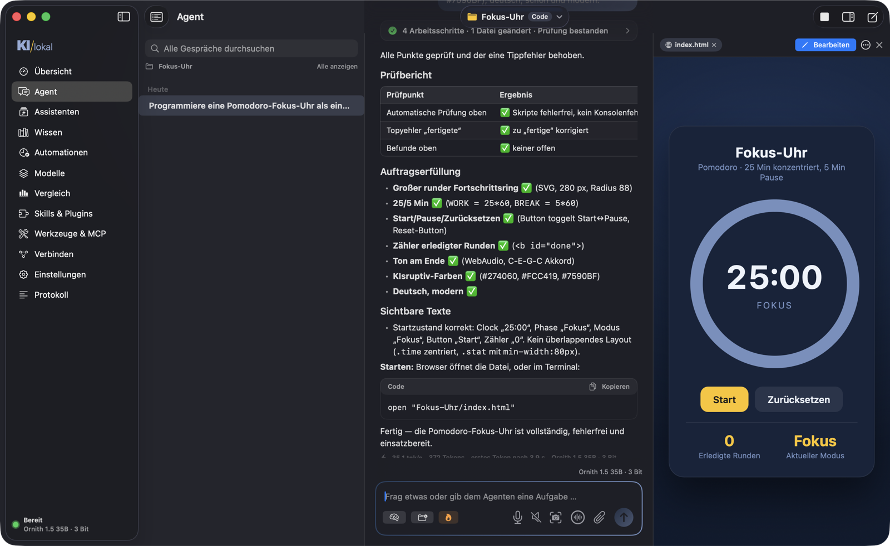

- Ändert der Agent eine Datei (auch per Terminal-Befehl), lädt die Vorschau neu.
- Fehler aus der Browser-Konsole erscheinen unter der Vorschau – **An Agent schicken** lässt ihn sie beheben.
- **Canvas:** Text-, Markdown-, Code- und HTML-Dateien öffnest du mit **Bearbeiten** als editierbaren Canvas. Markdown
  erscheint **formatiert** wie in einem Textprogramm (Überschriften, Fett, Listen, Tabellen – mit Werkzeugleiste und ⌘B/⌘I);
  „Markdown“ zeigt den Quelltext. Gespeichert wird automatisch; über das ⋯-Menü exportierst du als **PDF, Word oder HTML**.
- Bittest du um einen Entwurf, Brief oder „als Canvas“, öffnet der Agent ihn selbst als Canvas (`open_canvas`).
  Vor eigenen Änderungen liest er deine Fassung neu ein.

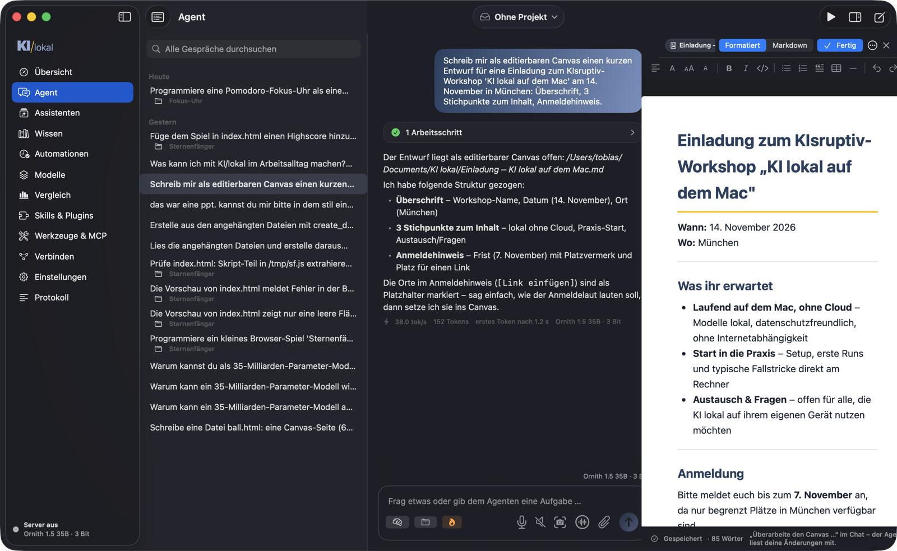

## 6. Dateien anhängen und Dokumente erzeugen

**Anhängen (📎 oder Drag & Drop):** KI/lokal liest den Inhalt lokal aus und gibt ihn dem Agenten mit.

| Datei | Was passiert |
|---|---|
| Bilder | gehen an das Vision-Modell |
| PDF, Word, RTF, Pages-Export, Text, Markdown, HTML | Text wird gelesen |
| **Excel** (.xlsx), CSV | Tabellenblätter als Tabellen |
| **PowerPoint** (.pptx) | Text jeder Folie |
| **ZIP** | wird entpackt; der Agent bekommt das Inhaltsverzeichnis und öffnet die Dateien selbst |
| **Audio/Video** | Hinweis auf die [Transkription](#7-assistenten) |
| alles andere | Name, Typ und Größe; der Agent kann es mit Werkzeugen untersuchen |

Lange Dokumente werden gekürzt mitgegeben – den Rest liest der Agent bei Bedarf selbst.

**Erzeugen (`create_document`):** Der Agent schreibt Markdown, KI/lokal macht daraus **PDF** (A4 mit Seitenumbrüchen),
**Word** (.docx), **Excel** (.xlsx – jede Tabelle ein Blatt), CSV, RTF oder HTML im KIsruptiv-Stil. Das Ergebnis
erscheint sofort in der Vorschau. Beispiel: *„Mach aus den angehängten Zahlen einen Bericht als PDF.“*

## 7. Assistenten

Der Bereich **Assistenten** ist die Galerie fertiger Funktionen: ein Klick, Datei oder Text dazu, fertig.

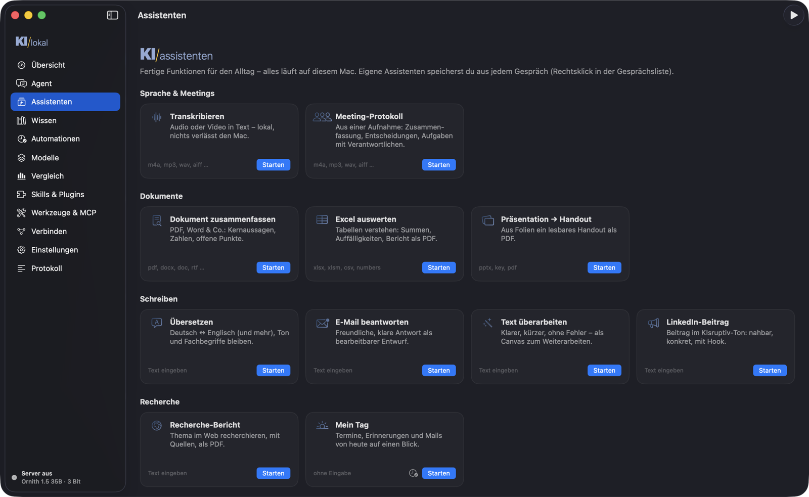

| Assistent | Was er tut |
|---|---|
| **Transkribieren** | Audio/Video → Text mit Zeitmarken, **lokal** (Spracherkennung von macOS), als .md neben der Aufnahme |
| **Meeting-Protokoll** | Aufnahme → Zusammenfassung, Entscheidungen, Aufgaben (wer, bis wann) als Word-Datei |
| Dokument zusammenfassen | Kernaussagen, Zahlen, Fristen, offene Punkte |
| Excel auswerten | Summen, Auffälligkeiten, Empfehlungen, Bericht als PDF |
| Präsentation → Handout | Folien in ganzen Sätzen als PDF |
| Übersetzen · E-Mail beantworten · Text überarbeiten · LinkedIn-Beitrag | Ergebnis als bearbeitbarer Canvas |
| Recherche-Bericht | Web-Recherche mit Quellen als PDF |
| Mein Tag | Termine, Erinnerungen, wichtige Mails |
| Code prüfen | Projektordner auf Fehler und Risiken prüfen |

- **Als Automation** (Uhr-Symbol): Assistenten ohne Eingabe laufen nach Zeitplan, z. B. jeden Morgen.
- **Eigene Assistenten:** In der Gesprächsliste per Rechtsklick *Als Assistent speichern* – die erste Nachricht des
  Gesprächs wird zum Auftrag.

**Begriffe kurz:** Ein *Assistent* ist eine sichtbare Funktion für dich. Ein *Skill* ist das Wissen dahinter, das der Agent
selbst lädt. Eine *Automation* ist ein Assistent nach Zeitplan.

## 8. Skills

Skills sind Anleitungen, die der Agent bei passenden Aufgaben selbst lädt (Format wie bei Claude Code: `SKILL.md`).

- **Aus Gesprächen lernen:** Nach einem gelungenen Ablauf *„Diesen Ablauf als Skill speichern“* oder Rechtsklick in der
  Gesprächsliste. Das Modell schreibt einen Entwurf (Wann verwenden, Schritte, Ergebnis prüfen, Stolperfallen), du prüfst
  und speicherst. Beim nächsten Mal weiß der Agent, wie es geht – ein persönliches Kochbuch.
- **Skills & Plugins:** mitgelieferte Skills, eigene Skills und Plugins aus Marketplaces (z. B. dem offiziellen
  Anthropic-Katalog) mit Befehlen, Sub-Agenten und MCP-Servern.

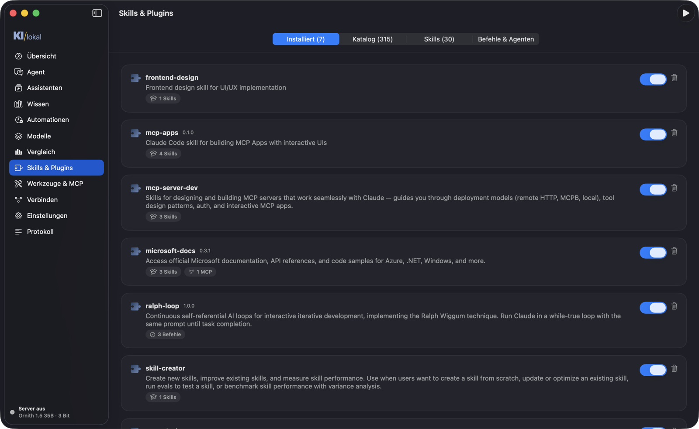

## 9. Freigaben, YOLO und Notbremse

Lesen, Suchen und Web-Abrufe laufen frei. **Schreiben, Terminal-Befehle, Browser-Aktionen, HTTP, MCP und Cloud** fragen
vorher. Die Freigabe-Karte sagt in Klartext, **was** der Agent tun will (Befehl, Datei, Adresse), **welches Risiko** das hat
und **warum** gefragt wird. Wahl: *Ablehnen*, *Erlauben* oder *Für dieses Gespräch alles erlauben*.

- **YOLO** (🔥): keine Rückfragen – praktisch für längere Aufgaben.
- **Notbremse** (an lassen!): fragt auch im YOLO-Modus bei `sudo`, `rm -rf`, Force-Push, Systembefehlen, Schreiben außerhalb
  deines Benutzerordners (auch per Terminal, z. B. in Homebrew-Ordnern) und Änderungen an systemweit installierten Paketen.
- Jede Aktion steht im **Protokoll** (wer, was, freigegeben/YOLO/abgelehnt, Ergebnis).

## 10. Weitere Bereiche

**Wissen:** Ordner indexieren (PDF, Word, Text, Code …) – der Agent durchsucht sie mit Stichwort- und Bedeutungssuche
und nennt die Quelle. Alles bleibt auf dem Mac.

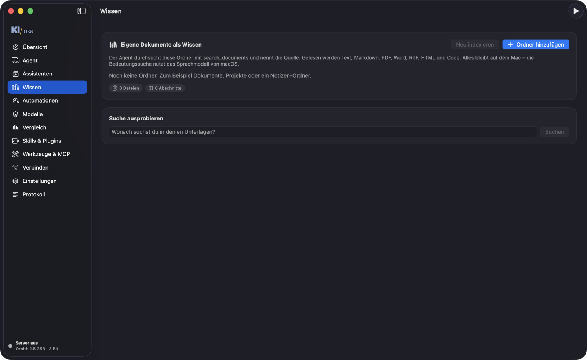

**Automationen:** Aufträge nach Zeitplan (Uhrzeit und Wochentage oder Intervall), z. B. das **Morgen-Briefing** mit
Terminen, Erinnerungen, Mails, Wetter und Nachrichten – als Mitteilung, vorgelesen oder als Datei.

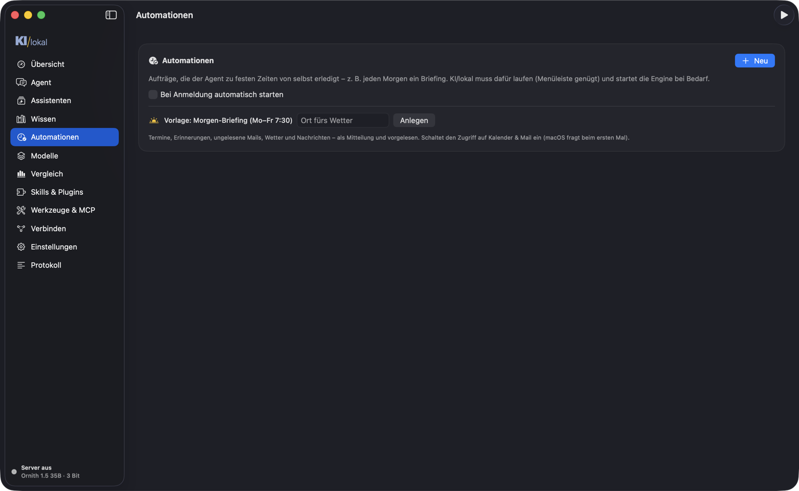

**Modelle:** Katalog mit Bewertung („läuft gut / langsam / knapp / zu groß“), Hugging-Face-Suche, Langer Kontext
(KV-Kompression, ~29k statt 14k Tokens) und Beschleunigung (MTP: automatisch nur für Code).

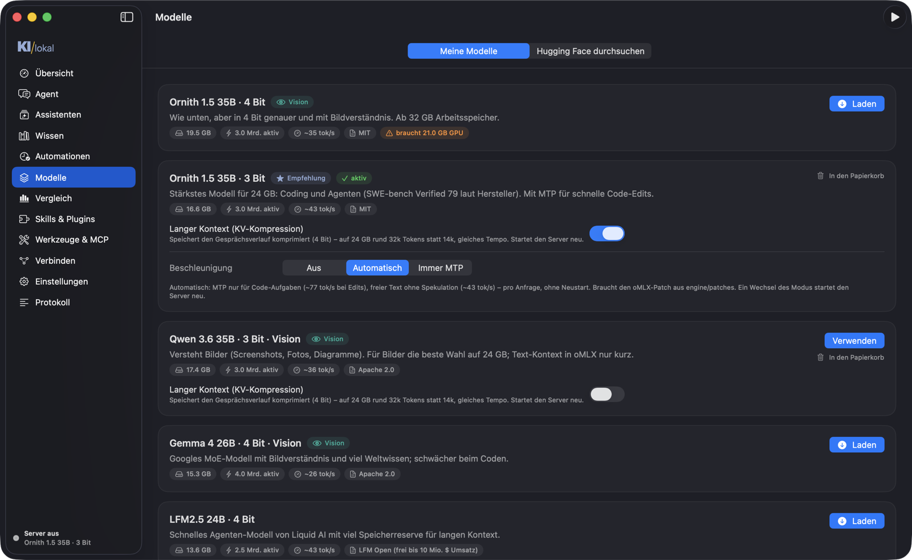

**Vergleich:** lokale Modelle neben GPT-6, Claude Opus 5.5 & Co. in bekannten Benchmarks – damit klar ist, wo lokal reicht.

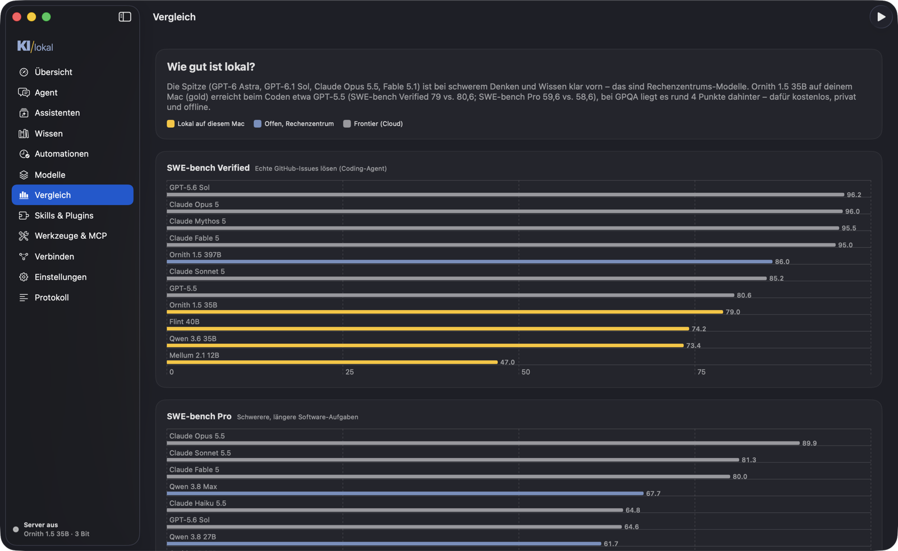

**Werkzeuge & MCP:** eingebaute Werkzeuge an/aus, MCP-Server verbinden (wie in Claude Desktop).
**Protokoll:** Aktionen des Agenten, Engine- und MCP-Log.

## 11. iPhone, Heimnetz und andere Programme

- **Heimnetz** (Einstellungen): KI/lokal im WLAN freigeben – mit zufälligem Schlüssel. Das iPhone scannt den QR-Code und
  nutzt den Web-Chat; andere Apps nutzen die OpenAI-kompatible Adresse. Ohne Freigabe ist die Engine nur auf diesem Mac
  erreichbar.
- **Verbinden:** fertige Befehle für Claude Code (lokales Modell statt Cloud), Claude Desktop und andere MCP-Clients
  (KI/lokal als MCP-Server) sowie OpenAI-kompatible Programme.

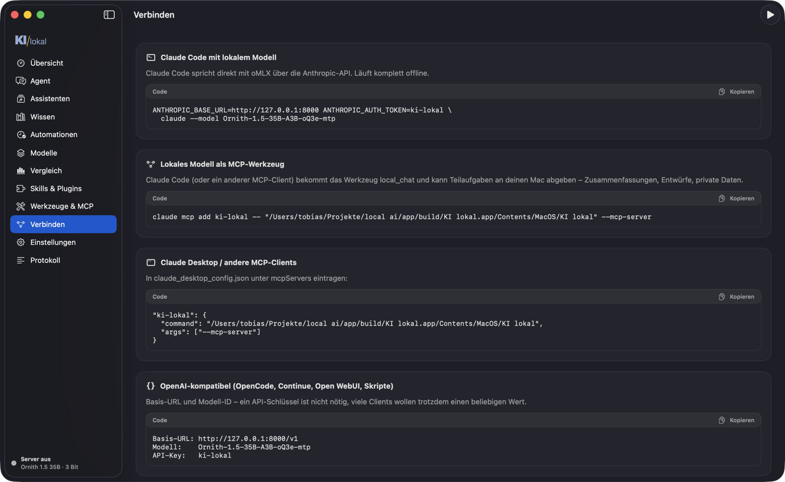

## 12. Terminal und Links

```bash
# Auftrag an die laufende App übergeben – erscheint live im Agent-Tab, Freigaben dort
"/Applications/KI lokal.app/Contents/MacOS/KI lokal" --agent "Fasse die Datei zusammen" --attach ~/Downloads/vertrag.pdf

# im Projekt eines Ordners (wird bei Bedarf angelegt), ohne Rückfragen
"/Applications/KI lokal.app/Contents/MacOS/KI lokal" --agent "Behebe die Tests" --workspace ~/Projekte/app --yolo
```

Weitere Schalter: `--mode chat|work|code`, `--steps N`, `--max-tokens N`, `--headless` (ohne Oberfläche),
`--selftest`, `--install-engine`, `--mcp-server`.

**Links** öffnen Bereiche direkt, z. B. aus Kurzbefehlen oder Notizen:
`kilokal://agent?projekt=Sternenfänger`, `kilokal://agent?vorschau=/Pfad/zur/datei.md&bearbeiten=1`,
`kilokal://agent?chat=<ID>`, `kilokal://uebersicht?engine=start`, `kilokal://assistenten`, `kilokal://modelle`,
`kilokal://einstellungen`.

## 13. Datenschutz

- Modelle, Gespräche, Wissen und Transkripte bleiben auf dem Mac (`~/.kilokal`). Ohne Cloud-Schlüssel verlässt nichts den Mac.
- Cloud-Modelle (Claude, OpenAI-kompatibel) und `ask_expert` sind optional und klar markiert („Daten verlassen den Mac“).
- Schlüssel liegen im Schlüsselbund von macOS. Die Engine lauscht ohne Heimnetz-Freigabe nur auf `127.0.0.1`.
- Mails werden nur als Entwurf angelegt, nie selbst gesendet.

## 14. Wenn etwas hakt

| Problem | Lösung |
|---|---|
| Erste Antwort dauert 20–30 s | Das Modell wird geladen – danach geht es schnell |
| Antworten werden langsamer | Mac heiß? Siehe *Nutzung & Mac*. Kurze Pause oder harte Unterlage |
| „Engine startet nicht“ | Übersicht → Engine einrichten; Protokoll → Engine-Log ansehen |
| Modell passt nicht in den Speicher | andere Apps schließen, GPU-Speicher erhöhen oder kleineres Modell |
| iPhone erreicht den Mac nicht | Heimnetz-Freigabe an? Engine in der App (neu) starten, gleiches WLAN |
| Absturz | Die Übersicht bietet beim nächsten Start „Melden“ an (vorausgefülltes GitHub-Issue) |
| Agent stoppt mit „Schrittlimit erreicht“ | **Weitermachen** klicken – oder in den Einstellungen mehr Schritte erlauben |

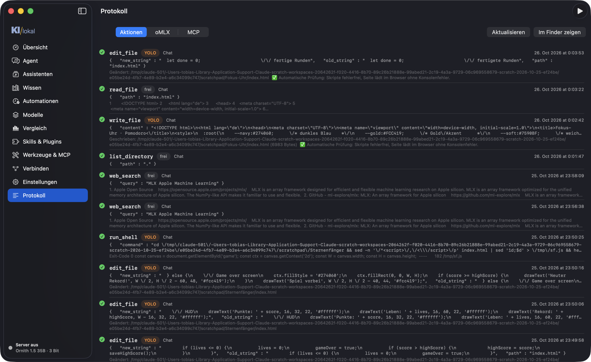
