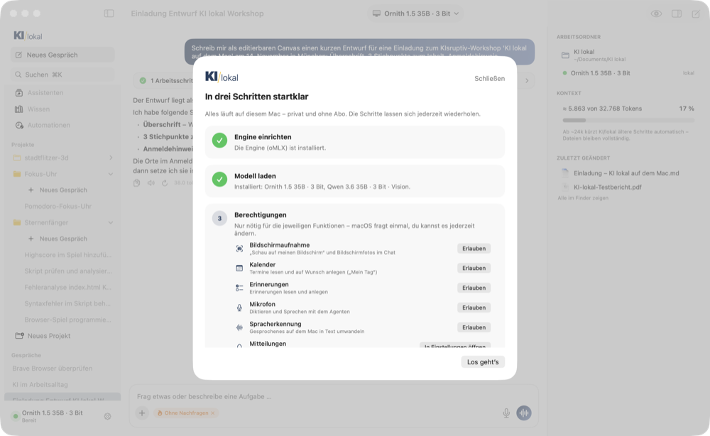
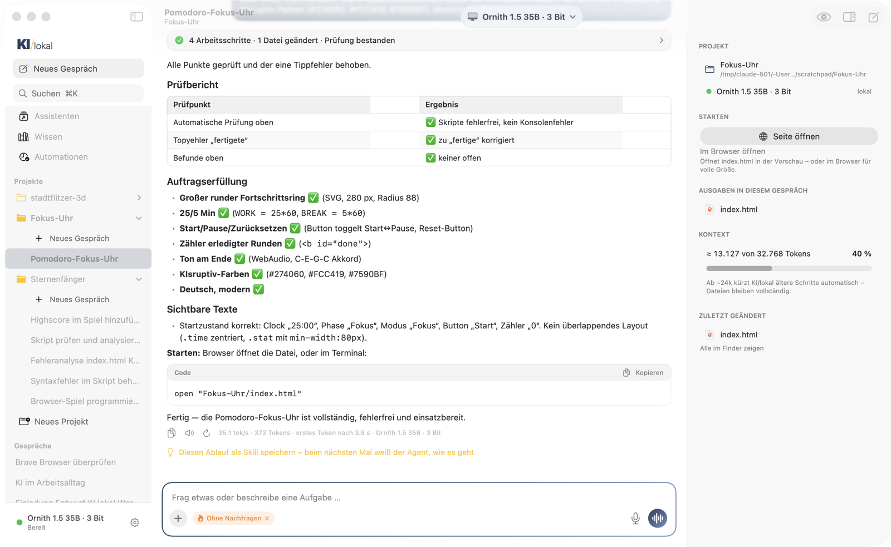

# KI/lokal – Anleitung

**KI für alle – direkt auf deinem Mac.** KI/lokal ist ein Tool von [KIsruptiv](https://kisruptiv.de): ein KI-Agent,
der vollständig auf deinem Mac läuft – privat, offline, ohne Abo. Diese Anleitung zeigt jeden Bereich der App.
Wofür es sich eignet, wo die Grenzen liegen und wie es sich von den Bezahl-Diensten abgrenzt: [Einordnung](EINORDNUNG.md).


## Inhalt

1. [Installation und erster Start](#1-installation-und-erster-start)
2. [Übersicht: Hardware, Nutzung, Temperatur](#2-übersicht)
3. [Agent: chatten, arbeiten, programmieren](#3-agent)
4. [Seitenleiste: Gespräche, Projekte, Automationen](#4-seitenleiste)
5. [Vorschau und Canvas](#5-vorschau-und-canvas)
6. [Dateien anhängen und Dokumente erzeugen](#6-dateien-anhängen-und-dokumente-erzeugen)
7. [Assistenten (fertige Funktionen) und Transkription](#7-assistenten)
8. [Skills: Abläufe wiederverwenden](#8-skills)
9. [Freigaben, „Ohne Nachfragen“ und Notbremse](#9-freigaben-und-notbremse)
10. [Wissen, Automationen, Modelle, Vergleich](#10-weitere-bereiche)
11. [iPhone, Heimnetz und andere Programme](#11-iphone-heimnetz-und-andere-programme)
12. [Terminal und Links](#12-terminal-und-links)
13. [Datenschutz](#13-datenschutz)
14. [Wenn etwas hakt](#14-wenn-etwas-hakt)

---

## 1. Installation und erster Start

1. **DMG öffnen** (`KI-lokal-0.7.0.dmg` aus den [Releases](https://github.com/tobwil/local-ai/releases)) und *KI/lokal* in den
   Programme-Ordner ziehen. Die App ist signiert und von Apple notarisiert – sie startet ohne Sicherheitswarnung.
   Oder selbst bauen: `app/Scripts/build.sh --install` (braucht Xcode und `brew install xcodegen`).
2. **Einrichtung in drei Schritten:** Beim ersten Start führt KI/lokal durch **Engine** (installiert
   [oMLX](https://github.com/jundot/omlx) nach `~/.kilokal`, ein paar Minuten), **Modell** (auf 24 GB:
   **Ornith 1.5 35B · 3 Bit**, 16,6 GB, mit Fortschritt) und **Berechtigungen** (Bildschirm, Kalender, Erinnerungen,
   Mikrofon, Spracherkennung, Mitteilungen – jeweils mit Status, *Erlauben* oder *In Einstellungen öffnen*). Später
   erreichbar über das Menü unten links → *Einrichtung & Berechtigungen*.
3. **Loslegen:** einfach schreiben. Läuft die Engine noch nicht, startet KI/lokal sie beim Abschicken selbst
   (beim ersten Mal lädt das Modell ~20–30 s, danach antwortet es nach 1–4 s).



> **Tipp:** Mit wenig freiem Arbeitsspeicher hilft „GPU-Speicher erhöhen“ in den Einstellungen (fragt nach deinem Passwort,
> gilt bis zum Neustart).

## 2. Übersicht

Die Übersicht zeigt, was dein Mac kann (Chip, Arbeitsspeicher, GPU-Limit, Bandbreite, freier SSD-Platz), welche Modelle
passen und wie schnell sie laufen. Darunter **Nutzung & Mac** – aktualisiert sich alle 5 Sekunden:

| Kachel | Bedeutung |
|---|---|
| Tokens verarbeitet | Eingabe (Prompt) + Ausgabe – seit Engine-Start oder insgesamt |
| Anfragen | Zahl der Anfragen an das Modell, laufende Anfragen live |
| Ø Antwort-Tempo | Ausgabe in Tokens pro Sekunde; darunter das Eingabe-Tempo |
| Cache-Treffer | Anteil der Eingabe, die aus dem Cache kam (spart Zeit bei langen Gesprächen) |
| Modell im Speicher | belegter Speicher und Speicherdruck |
| **Temperatur** | Chip-Temperatur in °C und Zustand (kühl · warm · heiß · kritisch) |

Wird der Mac heiß, drosselt macOS – lange Agent-Läufe werden langsamer (auf dem MacBook Air gemessen bis −24 %).
KI/lokal zeigt das mit einem Hinweis an.

## 3. Agent

Ein Eingabefeld für alles: Fragen beantworten, im Web recherchieren, Dateien bearbeiten, Termine anlegen, den Browser
steuern, programmieren. Der Agent wählt seine Werkzeuge selbst. Die Bedienung ist bewusst wie bei ChatGPT.


Ein neues Gespräch fragt *„Wobei kann ich helfen?“* – das Eingabefeld steht in der Mitte, darunter die wichtigsten
[Assistenten](#7-assistenten) und Beispiel-Aufträge zum Übernehmen. **Oben in der Mitte** wählst du das Modell: lokal
(privat, auf diesem Mac) oder Cloud (Daten verlassen den Mac); *Modelle verwalten …* führt zum Katalog.


**Antworten** erscheinen mit Überschriften, Listen und Tabellen. Darunter: **Kopieren**, **Vorlesen** und bei der
letzten Antwort **Neu generieren**, dazu Tempo (tok/s) und Tokens. An deiner letzten Nachricht erscheint beim
Überfahren ein **Stift**: Text ändern, ⌘↩ – alles danach wird neu beantwortet, Anhänge bleiben.

**Arbeitsschritte:** Was der Agent unterwegs tut (Dateien lesen, Befehle, Websuche …), steht kompakt in einer Zeile –
z. B. *„4 Arbeitsschritte · 1 Datei geändert · Prüfung bestanden“*. Ein Klick klappt die Schritte in Klartext auf
(„Gelesen: index.html“, „Im Web gesucht: …“), ein weiterer Klick auf einen Schritt zeigt Befehl und Ergebnis.

**Eingabefeld:**

| Element | Funktion |
|---|---|
| **＋** | Dateien hinzufügen, Bildschirmfoto (ganzer Bildschirm, Bereich, Fenster), **Gründlich nachdenken**, **Ohne Nachfragen arbeiten** (siehe [Freigaben](#9-freigaben-und-notbremse)), Arbeitsordner wählen, Antworten vorlesen |
| Chips | Was eingeschaltet ist (z. B. *Nachdenken*, *Ohne Nachfragen*) steht als Chip daneben – Klick auf × schaltet es aus |
| 🎙 Mikrofon | Diktieren (Spracherkennung auf dem Mac) |
| 〰️ Rund (leeres Feld) | **Sprechen:** reden – nach einer Pause wird abgeschickt – die Antwort wird vorgelesen – weiterreden |
| ↑ Senden | Mit Text im Feld; während der Agent arbeitet: **Vormerken** (⏱) und **Stoppen** |

- **Anhängen:** Dateien auf das Fenster ziehen, über ＋ wählen oder mit **⌘V** einfügen (Bildschirmfotos aus der
  Zwischenablage, im Finder kopierte Dateien). PDF, Word, Excel, PowerPoint, ZIP, Audio und Bilder.
- **Weiterschreiben, während der Agent arbeitet:** Die Nachricht wird vorgemerkt und geht raus, sobald er fertig ist
  (vorher änderbar oder verwerfbar).
- **Stoppen** (Esc): Die angefangene Antwort bleibt stehen; der Agent weiß beim nächsten Mal, dass du abgebrochen hast.

| Tastenkürzel | |
|---|---|
| ⌘N oder ⇧⌘O | Neues Gespräch |
| ⌘K | Gespräche durchsuchen |
| ↩ / ⇧↩ | Senden / neue Zeile |
| ⌘↩ | Bearbeitete Nachricht senden |
| Esc | Agent stoppen |

Während der Agent arbeitet, zeigt er an, was gerade passiert („liest Eingabe … 12 s“, „denkt nach“, Tempo in tok/s).

**Qualität eingebaut:** Das lokale Modell ist schnell, übersieht aber manchmal Fehler. Deshalb prüft KI/lokal selbst mit:
- Die App kennt die Programme auf deinem Mac (node, python3, git …) und sagt sie dem Modell – kein Suchen, kein Raten.
- Nach jedem Schreiben prüft sie die Datei automatisch: JavaScript, JSON, Python, Shell auf Syntax; **HTML-Seiten werden
  unsichtbar im Browser geladen** und auf Fehler geprüft. Der Befund mit Zeilennummer geht sofort an den Agenten.
- Bevor der Agent „fertig“ meldet, macht er einen **Qualitäts-Check**: Befunde behoben? Auftrag vollständig? Texte ohne
  Tippfehler? Was fehlt, behebt er selbst.
- Wird eine Antwort am Längenlimit abgeschnitten, macht er in kleineren Teilen weiter; kurz vor dem Schrittlimit wird er
  erinnert, zum Ende zu kommen.
- Hat das Projekt **Tests** (`tests/test_*.js` oder `.py`), laufen sie vor „fertig“ automatisch – erst wenn sie grün sind,
  gilt die Aufgabe als erledigt.
- Kündigt das Modell nur an („Ich starte …“) oder fragt nach Inhalten, die es selbst lesen könnte, erinnert die App es
  daran, das Werkzeug zu benutzen. Ganze Codeblöcke ersetzt es per Zeilennummer (`replace_lines`); beim Überschreiben einer
  Datei warnt die App, wenn Funktionen verloren gehen.
- Auf 24 GB passt nur begrenzt Verlauf in den Speicher: KI/lokal kürzt lange Werkzeug-Ergebnisse und Dateiinhalte im
  Verlauf automatisch (die Dateien selbst bleiben vollständig). Mehr Platz gibt „GPU-Speicher erhöhen“ in den Einstellungen.
Der Agent darf 50 Schritte am Stück machen, in Code-Projekten 100; danach pausiert er mit **Weitermachen**. Ruft er
dasselbe Werkzeug immer wieder gleich auf, weist ihn die App darauf hin. Lange Aufträge erscheinen im Chat eingeklappt. Nach gelungenen Abläufen mit mehreren Schritten schlägt
KI/lokal vor, sie [als Skill zu speichern](#8-skills).

## 4. Seitenleiste

Alles Wichtige steht in **einer Seitenleiste** – wie bei ChatGPT:

- oben **Neues Gespräch** und **Suche** über alle Gespräche (Titel und Inhalt),
- darunter **Assistenten**, **Wissen** und **Automationen**,
- **Projekte** als aufklappbare Ordner mit ihren Gesprächen (aufgeklappt oben *＋ Neues Gespräch* im Projekt),
- der Ordner **Automationen** mit jedem Ergebnis einer Automation als Gespräch (mit „neu“-Zähler) – dort direkt nachfragen,
- alle übrigen **Gespräche**,
- ganz unten das **Menü** mit Modell und Engine-Zustand: Übersicht, Modelle, Skills & Plugins, Werkzeuge & MCP,
  Verbinden, Einstellungen, Einrichtung & Berechtigungen, Vergleich, Protokoll, Engine an/aus.

Gespräche bekommen nach der ersten Antwort einen **kurzen Titel** vom Modell. Rechtsklick auf ein Gespräch:
**Anheften** (bleibt oben), **Umbenennen**, **Als Skill speichern**, **Als Assistent speichern**, In den Papierkorb.

**Projekte** bündeln Gespräche, einen Ordner und eigene Anweisungen – wie Projekte bei ChatGPT oder Claude.
*Neues Projekt* legt eins an (Name, Ordner, Anweisungen); Rechtsklick auf einen Projektordner: bearbeiten, im Finder öffnen.

- **Liegt im Ordner Code** (`.git`, `package.json`, `index.html` …), arbeitet der Agent automatisch wie ein Coding-Agent:
  Code-Werkzeuge, prüft nach jeder Änderung, schnelles Dekodieren (MTP, ~80 tok/s).
- Die Arbeitsweise lässt sich im Projekt auch fest einstellen (Automatisch · Nur Chat · Arbeiten · Code).

**Projekt-Leiste** (rechts, Symbol ▯ oben rechts): **Projekt** bzw. **Arbeitsordner** (Klick öffnet den Finder,
Rechtsklick „Im Terminal öffnen“), Git-Zweig, Modell, **Starten** (z. B. „Spiel starten“ oder „Seite öffnen“ für
`index.html`, sonst die Anleitung), **Ausgaben** des Gesprächs, **Kontext** (wie voll das 32k-Arbeitsgedächtnis ist; ab
~24k kürzt die App ältere Schritte) und die **zuletzt geänderten** Dateien – ein Klick öffnet sie in der Vorschau.



## 5. Vorschau und Canvas

Rechts neben dem Chat zeigt die **Vorschau**, was der Agent erzeugt: Webseiten und Spiele laufen live, Markdown wird
gesetzt, Bilder, PDF, Word, Excel und Videos zeigt QuickLook, Code erscheint mit Zeilennummern.


- Ändert der Agent eine Datei (auch per Terminal-Befehl), lädt die Vorschau neu.
- Fehler aus der Browser-Konsole erscheinen unter der Vorschau – **An Agent schicken** lässt ihn sie beheben.
- **Canvas:** Text-, Markdown-, Code- und HTML-Dateien öffnest du mit **Bearbeiten** als editierbaren Canvas. Markdown
  erscheint **formatiert** wie in einem Textprogramm (Überschriften, Fett, Listen, Tabellen – mit Werkzeugleiste und ⌘B/⌘I);
  „Markdown“ zeigt den Quelltext. Gespeichert wird automatisch; über das ⋯-Menü exportierst du als **PDF, Word oder HTML**.
- Bittest du um einen Entwurf, Brief oder „als Canvas“, öffnet der Agent ihn selbst als Canvas (`open_canvas`).
  Vor eigenen Änderungen liest er deine Fassung neu ein.


## 6. Dateien anhängen und Dokumente erzeugen

**Anhängen (＋, ⌘V oder Datei aufs Fenster ziehen):** KI/lokal liest den Inhalt lokal aus und gibt ihn dem Agenten mit.

| Datei | Was passiert |
|---|---|
| Bilder | gehen an das Vision-Modell |
| PDF, Word, RTF, Pages-Export, Text, Markdown, HTML | Text wird gelesen |
| **Excel** (.xlsx), CSV | Tabellenblätter als Tabellen |
| **PowerPoint** (.pptx) | Text jeder Folie |
| **ZIP** | wird entpackt; der Agent bekommt das Inhaltsverzeichnis und öffnet die Dateien selbst |
| **Audio/Video** | Hinweis auf die [Transkription](#7-assistenten) |
| alles andere | Name, Typ und Größe; der Agent kann es mit Werkzeugen untersuchen |

Lange Dokumente werden gekürzt mitgegeben – den Rest liest der Agent bei Bedarf selbst.

**Erzeugen (`create_document`):** Der Agent schreibt Markdown, KI/lokal macht daraus **PDF** (A4 mit Seitenumbrüchen),
**Word** (.docx), **Excel** (.xlsx – jede Tabelle ein Blatt), CSV, RTF oder HTML im KIsruptiv-Stil. Das Ergebnis
erscheint sofort in der Vorschau. Beispiel: *„Mach aus den angehängten Zahlen einen Bericht als PDF.“*

## 7. Assistenten

Der Bereich **Assistenten** ist die Galerie fertiger Funktionen: ein Klick, Datei oder Text dazu, fertig.


| Assistent | Was er tut |
|---|---|
| **Transkribieren** | Audio/Video – auch **WhatsApp-Sprachnachrichten** (.ogg) – → Text mit Zeitmarken, **lokal**, als .md neben der Aufnahme |
| **Meeting-Protokoll** | Aufnahme → Zusammenfassung, Entscheidungen, Aufgaben (wer, bis wann) als Word-Datei |
| Dokument zusammenfassen | Kernaussagen, Zahlen, Fristen, offene Punkte |
| Excel auswerten | Summen, Auffälligkeiten, Empfehlungen, Bericht als PDF |
| Präsentation → Handout | Folien in ganzen Sätzen als PDF |
| Übersetzen · E-Mail beantworten · Text überarbeiten · LinkedIn-Beitrag | Ergebnis als bearbeitbarer Canvas |
| Recherche-Bericht | Web-Recherche mit Quellen als PDF |
| Mein Tag | Termine, Erinnerungen, wichtige Mails |
| Code prüfen | Projektordner auf Fehler und Risiken prüfen |

- **Als Automation** (Uhr-Symbol): Assistenten ohne Eingabe laufen nach Zeitplan, z. B. jeden Morgen.
- **Eigene Assistenten:** In der Seitenleiste per Rechtsklick auf ein Gespräch *Als Assistent speichern* – die erste Nachricht des
  Gesprächs wird zum Auftrag.

**Begriffe kurz:** Ein *Assistent* ist eine sichtbare Funktion für dich. Ein *Skill* ist das Wissen dahinter, das der Agent
selbst lädt. Eine *Automation* ist ein Assistent nach Zeitplan.

## 8. Skills

Skills sind Anleitungen, die der Agent bei passenden Aufgaben selbst lädt (Format wie bei Claude Code: `SKILL.md`).

- **Aus Gesprächen lernen:** Nach einem gelungenen Ablauf *„Diesen Ablauf als Skill speichern“* oder Rechtsklick auf das
  Gespräch in der Seitenleiste. Das Modell schreibt einen Entwurf (Wann verwenden, Schritte, Ergebnis prüfen, Stolperfallen), du prüfst
  und speicherst. Beim nächsten Mal weiß der Agent, wie es geht – ein persönliches Kochbuch.
- **Wiederholungen erkennen:** Erledigt der Agent zum dritten Mal einen ähnlichen Auftrag (ähnliche Wörter, ähnliche
  Werkzeuge), schlägt der Chat vor, daraus einen Skill zu machen – aus **allen** passenden Gesprächen zusammen, damit
  die Anleitung den gemeinsamen Ablauf beschreibt statt eines Einzelfalls.
- **Mitgeliefert:** `web-recherche`, `code-review`, `dokumente-zusammenfassen`, `mac-helfer`, `skill-ersteller` und – angelehnt an
  [KiroCrew](https://github.com/kirodotdev/KiroCrew) – `ausfragen` (eine Entscheidung nach der anderen), `fehleranalyse`
  (Ursache eines eigenen Fehlers statt Entschuldigung), `fuenf-warum` (geführtes Tiefbohren), `gummiente` (Bericht gegen
  Quellen prüfen) und `perspektiven-rat` (Befürworter, Kritiker, Pragmatiker).
- **Skills & Plugins:** mitgelieferte Skills, eigene Skills und Plugins aus Marketplaces (z. B. dem offiziellen
  Anthropic-Katalog) mit Befehlen, Sub-Agenten und MCP-Servern.


## 9. Freigaben und Notbremse

Lesen, Suchen und Web-Abrufe laufen frei. **Schreiben, Terminal-Befehle, Browser-Aktionen, HTTP, MCP und Cloud** fragen
vorher. Die Freigabe-Karte sagt in Klartext, **was** der Agent tun will (Befehl, Datei, Adresse), **welches Risiko** das hat
und **warum** gefragt wird. Wahl: *Ablehnen*, *Erlauben* oder *Für dieses Gespräch alles erlauben*.

- **Ohne Nachfragen arbeiten** (＋ im Eingabefeld, früher „YOLO“): keine Rückfragen – praktisch für längere Aufgaben.
- **Notbremse** (an lassen!): fragt auch ohne Nachfragen bei `sudo`, `rm -rf`, Force-Push, Systembefehlen, Schreiben außerhalb
  deines Benutzerordners (auch per Terminal, z. B. in Homebrew-Ordnern) und Änderungen an systemweit installierten Paketen.
- **Zugangsdaten:** Lesen von `~/.ssh`, `~/.aws`, `~/.gnupg`, dem Schlüsselbund & Co. fragt immer nach (auch bei sonst freien
  Werkzeugen wie `read_file`). API-Schlüssel, Tokens und private Schlüssel in Werkzeug-Ergebnissen blendet die App aus –
  sie landen weder im Verlauf des Modells noch im Protokoll.
- **Sandbox** (Einstellungen → Agent): Shell-Befehle, die ohne deine Freigabe laufen (*Ohne Nachfragen*, Automationen, `--yolo` im
  Terminal), laufen in der macOS-Sandbox. Schreiben geht dort nur im Arbeitsordner, in `/tmp` und in Cache-Ordnern;
  Zugangsdaten sind gesperrt, Shell-Startdateien (`.zshrc` …), LaunchAgents und `~/.kilokal` geschützt. Was du einzeln
  freigibst, läuft im Standard ohne Sandbox; wahlweise *Immer* oder *Aus*.
- Jede Aktion steht im **Protokoll** (wer, was, freigegeben/ohne Nachfragen/abgelehnt, Ergebnis).

### Lektionen: aus Fehlern lernen

Korrigierst du den Agenten („nein, das stimmt nicht“, „du hast die Tests vergessen“) oder behebt er im Qualitäts-Check
einen Fehler, hält er die Regel dahinter mit `learn_lesson` fest – für dieses Projekt oder überall. Ab dann steht sie bei
jeder Anfrage im Systemprompt. Gerade ein kleines Modell profitiert davon: Was einmal schiefging, passiert seltener wieder.
Alle Lektionen siehst, ergänzt und löschst du unter **Einstellungen → Gedächtnis & Lektionen** (`~/.kilokal/lessons.json`).
Fakten über dich (`remember`) bleiben getrennt davon in `~/.kilokal/memory.md`.

### Lange Aufträge

- **Plan:** Bei Aufträgen mit vielen Schritten legt der Agent mit `update_plan` eine Checkliste an und hakt ab. Wird der
  Verlauf verdichtet, bleibt der Plan erhalten – der Agent verliert den Faden nicht.
- **Dranbleiben:** Am Schrittlimit macht der Agent bis zu 2× (einstellbar bis 20×) von selbst weiter, statt auf
  *Weitermachen* zu warten. Solange er arbeitet, schläft der Mac nicht ein. So lassen sich große Aufgaben über Nacht
  erledigen – lokal kostet jeder Token nichts.
- **Fortsetzen nach Neustart:** Der Stand wird nach jedem Schritt gespeichert. Wird die App mitten im Auftrag beendet
  oder stürzt sie ab, bietet der Agent-Tab beim nächsten Start *Fortsetzen* an – Verlauf, Plan und Projekt sind wieder da.

## 10. Weitere Bereiche

**Wissen:** Ordner indexieren (PDF, Word, Text, Code …) – der Agent durchsucht sie mit Stichwort- und Bedeutungssuche
und nennt die Quelle. Alles bleibt auf dem Mac.


**Automationen:** Aufträge nach Zeitplan (Uhrzeit und Wochentage oder Intervall), z. B. das **Morgen-Briefing** mit
Terminen, Erinnerungen, Mails, Wetter und Nachrichten – als Mitteilung, vorgelesen oder als Datei. Jedes Ergebnis
landet außerdem als Gespräch im Ordner **Automationen** der Seitenleiste. *Jetzt ausführen* startet sofort, ebenso der
Link `kilokal://automationen?ausfuehren=Name` (z. B. aus Kurzbefehlen).

**Überwachen ohne Modell:** Eine Automation kann zuerst einen Prüfbefehl ausführen (z. B. `curl` auf eine Webseite,
`df` für den Speicherplatz). Der läuft im Takt ohne Modell – kostet kaum Strom und keinen Speicher. Nur wenn der
Auslöser greift (*Ausgabe hat sich geändert*, *Befehl schlägt fehl*, *Befehl gibt etwas aus*), kommt eine Mitteilung –
oder der Agent bekommt die Ausgabe (bei „geändert“ auch den vorherigen Stand) und wertet sie aus. Vorlagen:
*Webseite beobachten*, *Dienst erreichbar?*, *Speicherplatz knapp*.


**Modelle:** Katalog mit Bewertung („läuft gut / langsam / knapp / zu groß“), Hugging-Face-Suche, Langer Kontext
(KV-Kompression, ~29k statt 14k Tokens) und Beschleunigung (MTP: automatisch nur für Code).


**Vergleich:** lokale Modelle neben GPT-6, Claude Opus 5.5 & Co. in bekannten Benchmarks – damit klar ist, wo lokal reicht.


**Werkzeuge & MCP:** eingebaute Werkzeuge an/aus, MCP-Server verbinden (wie in Claude Desktop).
**Protokoll:** Aktionen des Agenten, Engine- und MCP-Log (gleiche Engine-Meldungen hintereinander stehen als eine Zeile
mit Anzahl; gelbe WARNING-Zeilen sind Hinweise, keine Fehler).

## 11. iPhone, Heimnetz und andere Programme

- **Heimnetz** (Einstellungen): KI/lokal im WLAN freigeben – mit zufälligem Schlüssel. Das iPhone scannt den QR-Code und
  nutzt den Web-Chat; andere Apps nutzen die OpenAI-kompatible Adresse. Ohne Freigabe ist die Engine nur auf diesem Mac
  erreichbar.
- **Verbinden:** fertige Befehle für Claude Code (lokales Modell statt Cloud), Claude Desktop und andere MCP-Clients
  (KI/lokal als MCP-Server) sowie OpenAI-kompatible Programme.
- **KiroCrew:** [KiroCrew](https://github.com/kirodotdev/KiroCrew) ruft Modelle über die Agenten OpenCode oder Pi auf. Unter
  *Verbinden* stehen die fertigen Einträge für `~/.config/opencode/opencode.json` bzw. `~/.pi/agent/models.json` (Basis-URL
  `http://127.0.0.1:8000/v1`, Modell und Kontextgröße schon eingesetzt) und für `~/.kiro/crew/mcp.json`, damit KiroCrew
  KI/lokal umgekehrt als Werkzeug nutzt. Hinweis: Diese Agenten schicken lange Systemprompts mit – auf 24 GB wird es eng.


## 12. Terminal und Links

```bash
# Auftrag an die laufende App übergeben – erscheint live im Agent-Tab, Freigaben dort
"/Applications/KI lokal.app/Contents/MacOS/KI lokal" --agent "Fasse die Datei zusammen" --attach ~/Downloads/vertrag.pdf

# im Projekt eines Ordners (wird bei Bedarf angelegt), ohne Rückfragen
"/Applications/KI lokal.app/Contents/MacOS/KI lokal" --agent "Behebe die Tests" --workspace ~/Projekte/app --yolo
```

Weitere Schalter: `--weiter` (im offenen Gespräch weitermachen statt ein neues zu beginnen), `--mode chat|work|code`, `--steps N`, `--max-tokens N`, `--headless` (ohne Oberfläche),
`--selftest`, `--install-engine`, `--mcp-server`.

**Links** öffnen Bereiche direkt, z. B. aus Kurzbefehlen oder Notizen:
`kilokal://agent?projekt=Sternenfänger`, `kilokal://agent?vorschau=/Pfad/zur/datei.md&bearbeiten=1`,
`kilokal://agent?chat=<ID>`, `kilokal://uebersicht?engine=start`, `kilokal://assistenten`, `kilokal://modelle`,
`kilokal://einstellungen`.

## 13. Datenschutz

- Modelle, Gespräche, Wissen und Transkripte bleiben auf dem Mac (`~/.kilokal`). Ohne Cloud-Schlüssel verlässt nichts den Mac.
- Cloud-Modelle (Claude, OpenAI-kompatibel) und `ask_expert` sind optional und klar markiert („Daten verlassen den Mac“).
- Schlüssel liegen im Schlüsselbund von macOS. Die Engine lauscht ohne Heimnetz-Freigabe nur auf `127.0.0.1`.
- Mails werden nur als Entwurf angelegt, nie selbst gesendet.

## 14. Wenn etwas hakt

| Problem | Lösung |
|---|---|
| Erste Antwort dauert 20–30 s | Das Modell wird geladen – danach geht es schnell |
| Antworten werden langsamer | Mac heiß? Siehe *Nutzung & Mac*. Kurze Pause oder harte Unterlage |
| „Engine startet nicht“ | Übersicht → Engine einrichten; Protokoll → Engine-Log ansehen |
| Modell passt nicht in den Speicher | andere Apps schließen, GPU-Speicher erhöhen oder kleineres Modell |
| iPhone erreicht den Mac nicht | Heimnetz-Freigabe an? Engine in der App (neu) starten, gleiches WLAN |
| Absturz | Die Übersicht bietet beim nächsten Start „Melden“ an (vorausgefülltes GitHub-Issue) |
| Agent stoppt mit „Schrittlimit erreicht“ | **Weitermachen** klicken – oder in den Einstellungen mehr Schritte bzw. öfter „von selbst weitermachen“ erlauben |
| Shell-Befehl scheitert mit „Operation not permitted“ | Die Sandbox hat geschützt (ohne Nachfragen/Automation). Befehl einzeln freigeben oder Sandbox unter Einstellungen → Agent anpassen |


